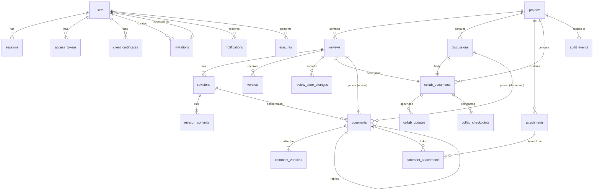

# Data specification

Status: draft for review. This spec refines
[design/data-model.md](../design/data-model.md) into the definitions that
implementation starts from. Per the
[development process](../development-process.md), data is defined before any
feature spec or code.

## 1. Scope

This document defines:

1. every stored entity, its columns, constraints and indexes (sections 3–4);
2. when each piece of data is created, read, changed and removed, and by whom
   (section 5);
3. every write operation, the rows it touches and its transaction boundary
   (section 6);
4. how concurrent access is coordinated so data stays consistent and the
   server stays live (section 7);
5. how the schema evolves (section 8).

Everything not stored is derived on demand: diffs, comment positions on later
revisions (comment porting), and unread counts.

## 2. Conventions

| Item | Rule |
|---|---|
| Identifiers | ULID as uppercase Crockford base32 text (`TEXT`, 26 characters). Time-ordered, so new rows append to indexes. Generated by `github.com/oklog/ulid/v2` through one ID generator (section 2.1) |
| Per-project numbers | Reviews also get a human-facing number per project (`#12`), allocated inside the creating transaction |
| Time | `INTEGER`, Unix time in milliseconds, UTC, from the injected clock. Never `CURRENT_TIMESTAMP` |
| Booleans | `INTEGER` with `CHECK (x IN (0, 1))` |
| Enumerations | `TEXT` with a `CHECK (x IN (...))` constraint, mirrored by a typed string constant in Go |
| Tables | `STRICT`, so SQLite enforces column types |
| Foreign keys | Always declared. `ON DELETE RESTRICT` by default, so nothing disappears implicitly. Project purge deletes children explicitly in order (section 6.6) |
| Secrets | Only SHA-256 digests of tokens and session identifiers, and Argon2id hashes of passwords, are stored |
| Free text | UTF-8, length checked in Go before insert; limits are in section 4 |

Connection settings applied to every connection: `foreign_keys=ON`,
`journal_mode=WAL`, `synchronous=NORMAL`, `busy_timeout=5000`,
`secure_delete=ON`.

### 2.1 ID generator

All identifiers come from one generator that is injected into every service.

| Part | Definition |
|---|---|
| Input | The injected clock and an entropy source (`crypto/rand` in production, a fixed reader in tests) |
| Output | A new ULID, or an error if entropy cannot be read |
| Logic | Take the clock's Unix milliseconds. If it is lower than the last value used, use the last value, so IDs never go backwards when the system clock does. Generate with `ulid.New(ms, monotonic)`, where `monotonic` is `ulid.Monotonic(entropy, 0)`, so IDs within the same millisecond stay strictly increasing |
| Side effects | Advances the generator's last timestamp and monotonic state only |
| Concurrency | `ulid.MonotonicEntropy` is not safe for concurrent use, so the generator holds a mutex around generation. The critical section does no I/O beyond reading entropy |
| Failure | Monotonic overflow within one millisecond (2^80 IDs) or an entropy read error returns an error; callers fail the operation without writing |

Choice record: ULID through `oklog/ulid` was chosen over UUIDv7 through
`google/uuid` and over a hand-written UUIDv7. `google/uuid` reads the time
from a package-level `time.Now`, so the clock cannot be injected, and it has
had no release since January 2024. `oklog/ulid` takes the timestamp as an
argument, supports monotonic ordering, is maintained by an organization with
a release in July 2026, and adds one module to the build. A hand-written
generator would add no module but adds code to verify. See the criteria in
[development-process.md](../development-process.md#7-choosing-a-library).

## 3. Entity-relationship diagram

`comments.parent` points either to a review or to a discussion. SQLite cannot
declare one foreign key over two tables, so the table has two nullable foreign
keys and a `CHECK` that exactly one is set.

## 4. Tables

Column notes: **PK** primary key, **FK** foreign key, **U** unique,
**N** nullable. Columns without N are `NOT NULL`.

### 4.1 Identity

**users**

| Column | Type | Notes |
|---|---|---|
| `id` | TEXT | PK |
| `username` | TEXT | U, `^[a-z0-9][a-z0-9_-]{1,31}$` |
| `display_name` | TEXT | 1–64 characters |
| `password_hash` | TEXT | Argon2id in PHC string format |
| `role` | TEXT | `admin`, `member` |
| `created_at` | INTEGER | |
| `disabled_at` | INTEGER | N |

**invitations**

| Column | Type | Notes |
|---|---|---|
| `id` | TEXT | PK |
| `token_sha256` | BLOB | U, 32 bytes |
| `role` | TEXT | `admin`, `member` |
| `created_by` | TEXT | FK users |
| `created_at` | INTEGER | |
| `expires_at` | INTEGER | |
| `revoked_at` | INTEGER | N |
| `used_at` | INTEGER | N |
| `used_by` | TEXT | N, FK users, U |

Index: `(used_at, revoked_at, expires_at)` to decide whether the enrollment
listener must be open.

**sessions**

| Column | Type | Notes |
|---|---|---|
| `id_sha256` | BLOB | PK |
| `user_id` | TEXT | FK users |
| `certificate_serial` | TEXT | N, FK client_certificates. The device the session was opened from |
| `csrf_token_sha256` | BLOB | |
| `created_at` | INTEGER | |
| `last_seen_at` | INTEGER | Updated at most once per minute per session |
| `expires_at` | INTEGER | |

Index: `(user_id)`, `(expires_at)`.

**access_tokens**

| Column | Type | Notes |
|---|---|---|
| `id` | TEXT | PK |
| `user_id` | TEXT | FK users |
| `name` | TEXT | 1–64 characters, U per user |
| `token_sha256` | BLOB | U |
| `created_at` | INTEGER | |
| `last_used_at` | INTEGER | N, updated at most once per minute |
| `revoked_at` | INTEGER | N |

**client_certificates**

| Column | Type | Notes |
|---|---|---|
| `serial` | TEXT | PK, 128-bit random serial as hex |
| `user_id` | TEXT | FK users |
| `device_name` | TEXT | 1–64 characters |
| `public_key_sha256` | BLOB | SHA-256 of the SubjectPublicKeyInfo |
| `issued_via` | TEXT | `invitation`, `renewal`, `setup` |
| `renewed_from` | TEXT | N, FK client_certificates |
| `not_before` | INTEGER | |
| `not_after` | INTEGER | |
| `revoked_at` | INTEGER | N |

Index: `(user_id, revoked_at)`.

### 4.2 Projects and reviews

**projects**

| Column | Type | Notes |
|---|---|---|
| `id` | TEXT | PK |
| `name` | TEXT | U, `^[a-z0-9][a-z0-9._-]{0,63}$` |
| `description` | TEXT | 0–500 characters |
| `created_by` | TEXT | FK users |
| `created_at` | INTEGER | |
| `next_review_number` | INTEGER | Starts at 1 |

**reviews**

| Column | Type | Notes |
|---|---|---|
| `id` | TEXT | PK |
| `project_id` | TEXT | FK projects |
| `number` | INTEGER | U with `project_id` |
| `title` | TEXT | 1–200 characters |
| `source_branch` | TEXT | Full ref name, `refs/heads/...` |
| `target_branch` | TEXT | Full ref name |
| `state` | TEXT | `open`, `completed`, `abandoned` |
| `author_id` | TEXT | FK users |
| `description_doc_id` | TEXT | FK collab_documents, U |
| `created_at` | INTEGER | |
| `updated_at` | INTEGER | Last activity, for list ordering |

A partial unique index allows at most one open review per source branch:
`UNIQUE (project_id, source_branch) WHERE state = 'open'`.

**revisions**

| Column | Type | Notes |
|---|---|---|
| `id` | TEXT | PK |
| `review_id` | TEXT | FK reviews |
| `number` | INTEGER | U with `review_id`, starts at 1 |
| `base_sha` | TEXT | 40 or 64 hex characters |
| `head_sha` | TEXT | Same |
| `pushed_by` | TEXT | FK users |
| `pushed_at` | INTEGER | |

**revision_commits**

| Column | Type | Notes |
|---|---|---|
| `revision_id` | TEXT | PK part, FK revisions |
| `position` | INTEGER | PK part, 0 = oldest |
| `sha` | TEXT | |
| `subject` | TEXT | First line of the message, up to 200 characters |
| `author_name` | TEXT | From the commit, up to 200 characters |
| `authored_at` | INTEGER | |

A revision is limited to 500 commits (proposed default); a larger push is
recorded as a revision with a flag instead of a commit list.

**verdicts** (append-only)

| Column | Type | Notes |
|---|---|---|
| `id` | TEXT | PK |
| `review_id` | TEXT | FK reviews |
| `revision_id` | TEXT | FK revisions. The revision the verdict was given on |
| `user_id` | TEXT | FK users |
| `value` | TEXT | `approve`, `request_changes` |
| `created_at` | INTEGER | |

Index: `(review_id, user_id, created_at)`. The current verdict of a user is
the latest row.

**review_state_changes** (append-only)

| Column | Type | Notes |
|---|---|---|
| `id` | TEXT | PK |
| `review_id` | TEXT | FK reviews |
| `from_state` | TEXT | |
| `to_state` | TEXT | |
| `user_id` | TEXT | FK users |
| `created_at` | INTEGER | |

### 4.3 Comments

**comments**

| Column | Type | Notes |
|---|---|---|
| `id` | TEXT | PK |
| `project_id` | TEXT | FK projects |
| `review_id` | TEXT | N, FK reviews |
| `discussion_id` | TEXT | N, FK discussions |
| `thread_root_id` | TEXT | N, FK comments. Null for a root comment |
| `author_id` | TEXT | FK users |
| `anchor_revision_id` | TEXT | N, FK revisions. Set for code comments |
| `anchor_view` | TEXT | N, `revision`, `commit`, `range` |
| `anchor_from_sha` | TEXT | N |
| `anchor_to_sha` | TEXT | N |
| `anchor_path` | TEXT | N, up to 4096 bytes |
| `anchor_side` | TEXT | N, `old`, `new` |
| `anchor_start_line` | INTEGER | N, ≥ 1 |
| `anchor_end_line` | INTEGER | N, ≥ `anchor_start_line` |
| `resolved` | INTEGER | 0 or 1. Meaningful on thread roots only |
| `current_version` | INTEGER | Latest `comment_versions.version` |
| `created_at` | INTEGER | |
| `deleted_at` | INTEGER | N |
| `deleted_by` | TEXT | N, FK users |

Checks:

- exactly one of `review_id`, `discussion_id` is set;
- anchor columns are all null, or `anchor_revision_id`, `anchor_view`,
  `anchor_from_sha`, `anchor_to_sha`, `anchor_path` and `anchor_side` are all
  set (lines may be null for a file-level comment);
- anchors are allowed only when `review_id` is set and the comment is a root.

Indexes: `(review_id, thread_root_id, created_at)`,
`(discussion_id, thread_root_id, created_at)`,
`(anchor_revision_id, anchor_path)`.

**comment_versions** (append-only)

| Column | Type | Notes |
|---|---|---|
| `comment_id` | TEXT | PK part, FK comments |
| `version` | INTEGER | PK part, starts at 1 |
| `body` | TEXT | Markdown, 1–65,536 bytes |
| `created_at` | INTEGER | |

**comment_attachments**

| Column | Type | Notes |
|---|---|---|
| `comment_id` | TEXT | PK part, FK comments |
| `attachment_id` | TEXT | PK part, FK attachments |

### 4.4 Discussions and collaborative documents

**discussions**

| Column | Type | Notes |
|---|---|---|
| `id` | TEXT | PK |
| `project_id` | TEXT | FK projects |
| `title` | TEXT | 1–200 characters |
| `author_id` | TEXT | FK users |
| `body_doc_id` | TEXT | FK collab_documents, U |
| `created_at` | INTEGER | |
| `updated_at` | INTEGER | |
| `deleted_at` | INTEGER | N |

**collab_documents**

| Column | Type | Notes |
|---|---|---|
| `id` | TEXT | PK |
| `project_id` | TEXT | FK projects |
| `kind` | TEXT | `review_description`, `discussion_body` |
| `next_seq` | INTEGER | Next update sequence number, starts at 1 |
| `generation` | INTEGER | Starts at 1, incremented when the document is rebuilt by an erasure |
| `created_at` | INTEGER | |

**collab_updates** (append-only within a generation)

| Column | Type | Notes |
|---|---|---|
| `document_id` | TEXT | PK part, FK collab_documents |
| `seq` | INTEGER | PK part |
| `user_id` | TEXT | FK users |
| `received_at` | INTEGER | |
| `payload` | BLOB | Raw Yjs update, up to 1 MiB |

**collab_checkpoints**

| Column | Type | Notes |
|---|---|---|
| `document_id` | TEXT | PK part, FK collab_documents |
| `up_to_seq` | INTEGER | PK part. Includes all updates with `seq ≤ up_to_seq` |
| `state` | BLOB | Full Yjs state encoded by ygo |
| `text` | TEXT | Plain text extracted from the state |
| `contributors` | TEXT | JSON array of user IDs whose updates are included since the previous checkpoint |
| `created_at` | INTEGER | |

### 4.5 Attachments, notifications, audit

**attachments**

| Column | Type | Notes |
|---|---|---|
| `id` | TEXT | PK |
| `project_id` | TEXT | FK projects |
| `uploader_id` | TEXT | FK users |
| `filename` | TEXT | Display only, 1–255 bytes, path separators removed |
| `media_type` | TEXT | Detected from content, not trusted from the client |
| `size` | INTEGER | Bytes, ≤ 25 MiB (proposed default) |
| `sha256` | BLOB | Content address of the stored file |
| `created_at` | INTEGER | |
| `deleted_at` | INTEGER | N |

Files are stored per project at `data/attachments/<project_id>/<sha256-hex>`,
so a purge removes the project's directory and never touches another
project's files.

**notifications**

| Column | Type | Notes |
|---|---|---|
| `id` | TEXT | PK |
| `user_id` | TEXT | FK users |
| `project_id` | TEXT | FK projects |
| `kind` | TEXT | `mention`, `comment_on_my_review`, `reply_to_me`, `verdict_on_my_review`, `revision_on_reviewed` |
| `subject_kind` | TEXT | `comment`, `review`, `discussion`, `revision` |
| `subject_id` | TEXT | |
| `created_at` | INTEGER | |
| `read_at` | INTEGER | N |

Index: `(user_id, read_at, created_at)`.

**audit_events** (append-only)

| Column | Type | Notes |
|---|---|---|
| `id` | TEXT | PK |
| `project_id` | TEXT | N, FK projects. Null for server-level events |
| `actor_id` | TEXT | N, FK users. Null for system actions |
| `action` | TEXT | Dotted name, for example `review.created`, `comment.edited` |
| `subject_kind` | TEXT | |
| `subject_id` | TEXT | |
| `data` | TEXT | JSON object. Never contains secrets or content bodies |
| `created_at` | INTEGER | |

Index: `(project_id, created_at)`, `(subject_kind, subject_id)`.

**erasures** (append-only, survives project purge)

| Column | Type | Notes |
|---|---|---|
| `id` | TEXT | PK |
| `actor_id` | TEXT | FK users |
| `scope` | TEXT | `comment`, `attachment`, `collab_document`, `project` |
| `subject_id` | TEXT | ID of the erased item. No foreign key, since the item is gone |
| `subject_label` | TEXT | For `project`, the project name. Otherwise empty |
| `reason` | TEXT | 1–500 characters, required |
| `created_at` | INTEGER | |

## 5. Data lifecycle

C create, R read, U update, D delete (hard), S soft delete, P removed by
project purge.

| Entity | Created by, when | Read by | Updated | Removed |
|---|---|---|---|---|
| users | Enrollment; first-admin setup | Every authenticated request (through session or token) | `display_name`, `password_hash`; `disabled_at` by admin | Never (kept for attribution) |
| invitations | Admin | Enrollment listener; listener open/close check | `used_*` on enrollment, `revoked_at` by admin | Never |
| sessions | Login | Every browser request | `last_seen_at` (throttled) | D on logout, expiry sweep, user disable |
| access_tokens | User | Every Git request | `last_used_at` (throttled), `revoked_at` | Never (revoked rows kept) |
| client_certificates | Enrollment, renewal, setup | Every TLS handshake (from an in-memory set, section 7.4) | `revoked_at` | Never |
| projects | Admin | Almost every request | `description` | P (row deleted, `erasures` row kept) |
| reviews | Member, from a pushed branch | Review pages, push handler | `state`, `title`, `updated_at` | P |
| revisions | Push handler | Review pages, diff, porting | Never | P |
| revision_commits | Push handler, same transaction as the revision | Commit list, per-commit view | Never | P |
| verdicts | Member | Review page | Never | P |
| review_state_changes | State change | History | Never | P |
| comments | Member | Review and discussion pages | `resolved`, `current_version`, `deleted_*` | S by author or admin; D by erasure; P |
| comment_versions | Comment create and edit | Comment display, edit history | Never | D by erasure; P |
| discussions | Member | Discussion pages | `title`, `updated_at`, `deleted_at` | S; P |
| collab_documents | With its review or discussion | Collaboration handler | `next_seq`, `generation` | P |
| collab_updates | Collaboration handler, per received update | Document load | Never | D by erasure (whole document); P |
| collab_checkpoints | Collaboration handler after a quiet period | Document load, history, export, mention scan | Never | D by erasure; P |
| attachments | Upload | Download, comment display | `deleted_at` | S; D by erasure; P |
| notifications | Inbox service, from events | Inbox | `read_at` | D after 90 days (proposed default); P |
| audit_events | Every service, same transaction as the change | History pages, export | Never | P (project-scoped rows) |
| erasures | Erasure and purge | Admin history | Never | Never |

Git data follows the same lifecycle: branch refs are written by pushes,
`refs/garret/reviews/<review>/revisions/<n>` by the push handler, and the whole
repository directory is removed by purge.

## 6. Write operations

Every operation below runs in one `BEGIN IMMEDIATE` transaction on the writer
connection (section 7.1), writes its audit event in the same transaction, and
publishes real-time events only after the commit succeeds.

### 6.1 Enrollment

Reads the invitation by token digest; checks unused, unrevoked, unexpired.
Inserts `users`, `client_certificates`; sets `invitations.used_at/used_by`.
Fails without side effects if the username is taken or the invitation was used
concurrently (`used_by` is unique and the update is conditional on
`used_at IS NULL`).

### 6.2 Push received

Runs after `git-receive-pack` finishes, per changed ref:

1. Outside the transaction: resolve the merge base and list commits with
   `git`, under the Git semaphore (section 7.3).
2. In one transaction: find the open review for the branch; if the head
   changed, insert `revisions` (number = max + 1) and `revision_commits`,
   update `reviews.updated_at`, insert the audit event.
3. After commit: write the hidden ref for the new revision, then publish
   `revision.created`.

If step 3 fails, the revision row exists but its head is not pinned yet. A
startup check re-creates missing hidden refs from `revisions.head_sha`, so the
failure is recoverable and visible in logs. Pinning before the transaction
was rejected because a failed transaction would then leave an orphan ref.

### 6.3 Comment create, edit, resolve, delete

- Create: insert `comments` with `current_version = 1` and
  `comment_versions(version 1)`; link attachments; insert notifications for
  mentions and watchers.
- Edit: conditional on `author_id` and `deleted_at IS NULL`; insert the next
  version and update `current_version` with
  `WHERE current_version = :expected` so concurrent edits fail instead of
  overwriting (optimistic concurrency).
- Resolve: update `resolved` on the thread root.
- Delete: set `deleted_at`, `deleted_by`.

### 6.4 Verdicts and state changes

Insert into `verdicts` or `review_state_changes`; update `reviews.state` only
through the state change, conditional on the expected current state.

### 6.5 Collaborative update

Inside the document's owner goroutine (section 7.5): allocate
`seq = next_seq`, insert `collab_updates`, increment `next_seq`, commit, then
apply to the in-memory document and broadcast. Applying before the commit was
rejected because a failed write would leave peers with an update that is not
stored.

### 6.6 Erasure and project purge

- Comment erasure: delete the comment's `comment_attachments` and all its
  `comment_versions`. If the comment has replies, keep the `comments` row as a
  placeholder with `deleted_at` set and `current_version = 0`, so the replies
  keep their thread; otherwise delete the row. Insert `erasures`.
- Collaborative document erasure: in the owner goroutine, delete all
  `collab_updates` and `collab_checkpoints` of the document, increment
  `generation`, insert a new checkpoint built from the cleaned text, insert
  `erasures`. Connected clients are told to reload.
- Project purge: requires a completed export. Deletes in dependency order
  (notifications, comment_attachments, comment_versions, comments,
  collab_checkpoints, collab_updates, verdicts, review_state_changes,
  revision_commits, revisions, reviews, discussions, collab_documents,
  attachments, audit_events, projects) in one transaction, inserts `erasures`,
  then removes the repository and attachment directories, then runs
  `wal_checkpoint(TRUNCATE)` and `VACUUM`. A crash after the commit but before
  the directory removal is completed by a startup check that removes
  directories with no matching project.

## 7. Concurrency model

### 7.1 Database connections

- **One writer connection.** A `*sql.DB` with `SetMaxOpenConns(1)` that owns
  every write. Writers queue on that one connection, so SQLite never returns
  `SQLITE_BUSY` between garret's own writers. Transactions start with
  `BEGIN IMMEDIATE` to take the write lock up front.
- **A reader pool.** A second `*sql.DB` opened with `mode=ro` and
  `query_only=ON`, limited to `max(2, min(GOMAXPROCS, 8))` connections. WAL
  lets readers run while the writer commits.
- **Short transactions.** No network, Git or file I/O inside a write
  transaction. Every transaction runs under a context with a timeout
  (proposed default 5 s), so one stuck operation cannot hold the write lock.

### 7.2 Per-key serialization

Operations that read then write the same aggregate are serialized per key
with a keyed mutex (a map of reference-counted mutexes guarded by one mutex):

| Key | Serialized operations |
|---|---|
| review ID | Push handling, state changes, verdicts on the same review |
| collaborative document ID | Handled by the document owner goroutine instead (7.5) |
| project ID | Purge versus every other write to that project |

Purge takes the project key exclusively and other writers take it shared
(a reader–writer lock per project), so a purge waits for in-flight writes and
blocks new ones.

### 7.3 Bounded external work

- **Git subprocesses.** A weighted semaphore limits concurrent `git`
  processes to `max(1, min(GOMAXPROCS-1, 4))`. Each acquisition uses the
  request context, so a waiting request gives up when the client leaves.
- **Diff computation.** Results are cached in memory by
  `(from_sha, to_sha, path)` in a bounded LRU cache; commit hashes make cached
  diffs immutable, so the cache needs no invalidation.

### 7.4 Certificate checks

Active client certificate serials are held in memory in a copy-on-write map
behind an `atomic.Pointer`. Handshakes read it without locking. Issuance and
revocation commit to the database first, then publish a new map. Revocation
therefore takes effect for new handshakes immediately after the commit;
existing connections of a revoked certificate are closed by the connection
registry.

### 7.5 Collaborative document owners

Each loaded document has one owner goroutine that holds the ygo document and
receives client updates on a bounded channel. Only the owner writes the
document's rows, so sequence numbers need no further locking. The owner stops
when the last client disconnects and a grace period passes, or when the server
context is cancelled.

### 7.6 Real-time hub

One hub goroutine owns the set of WebSocket connections. Services hand events
to it through a bounded channel after commit. Each connection has its own
bounded send buffer; a connection whose buffer is full is closed instead of
blocking the hub, and the client reconnects and re-fetches. Event delivery is
best effort by design (clients treat events as hints), so a slow client never
stalls writers.

### 7.7 Shutdown

The server context is cancelled on `SIGINT` or `SIGTERM`. HTTP servers stop
accepting, in-flight requests get a deadline (proposed default 10 s),
document owners flush a final checkpoint, the hub closes connections, and the
writer connection closes last.

## 8. Schema evolution

- goose migrations in `internal/store/migrations/NNNN_name.sql`, one
  transaction per migration, applied at startup before any listener opens.
- A migration is never edited after merge. Columns are added as nullable or
  with defaults; renames and type changes use SQLite's create-copy-swap
  pattern inside the migration.
- Startup refuses to run if the database schema version is newer than the
  binary knows (a downgrade).
- sqlc reads the same migration files as its schema source, so generated code
  always matches the migrations.

## 9. Open questions

| # | Question | Proposed answer |
|---|---|---|
| Q1 | Revision commit limit | 500 commits per revision |
| Q2 | Notification retention | 90 days |
| Q3 | Write transaction timeout | 5 seconds |
| Q4 | Shutdown deadline | 10 seconds |
| Q5 | Collaborative update size limit | 1 MiB per update |

These are proposed defaults and do not change any design decision.
